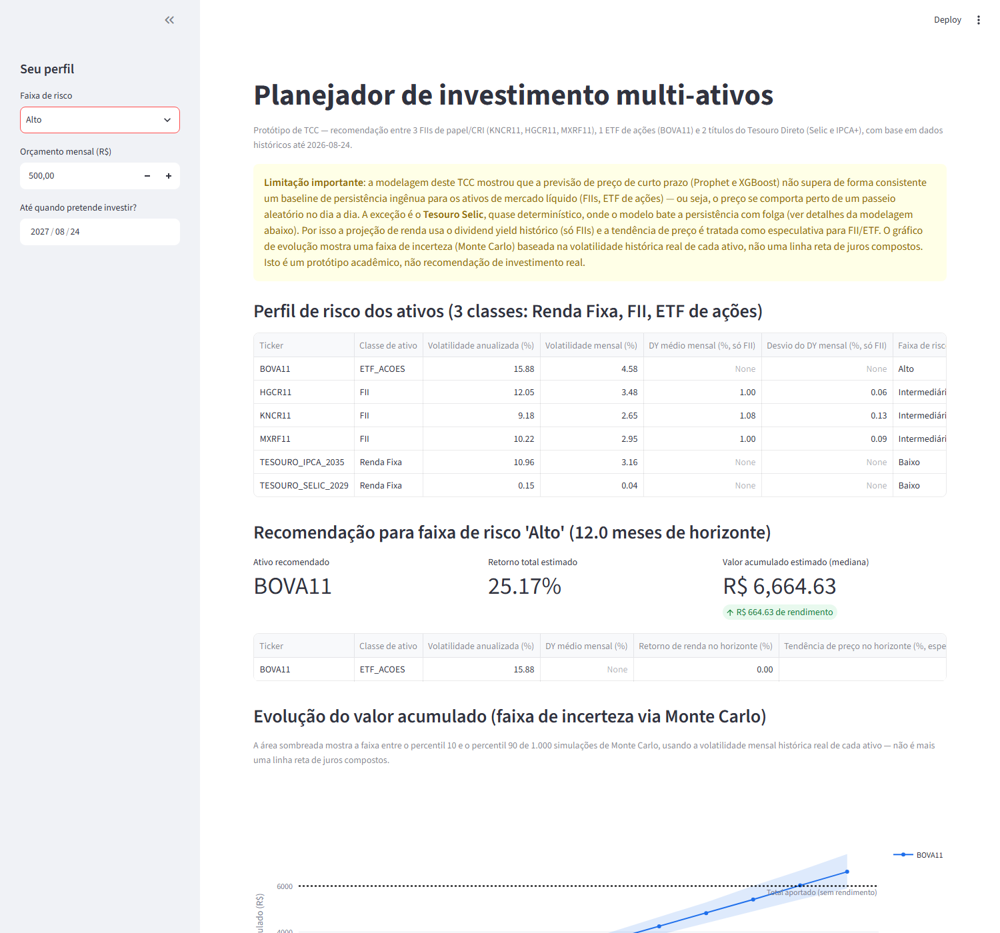

# Projeção de Investimentos — Previsão e Recomendação Multiativos com Machine Learning

Projeto pessoal de **análise de dados e machine learning** que coleta dados oficiais do mercado brasileiro, compara modelos de previsão e transforma os resultados em um **simulador de investimentos** por perfil de risco.

> Simulação educacional — não é recomendação de investimento.



## O que o projeto faz

1. **Coleta (ETL)** — baixa, faz parsing e normaliza dados oficiais da **B3 (COTAHIST)**, **CVM** (informe mensal de FIIs) e **Tesouro Transparente** para 6 ativos de 3 classes de risco (FIIs, ETF BOVA11 e Tesouro Direto), gerando um dataset unificado de ~4 mil registros diários (2024–2026).
2. **Feature engineering** — lags, médias móveis, retornos, Dividend Yield e P/VP, com **controle explícito de data leakage** (defasagem antes das janelas móveis) e split temporal 80/20 sem embaralhamento.
3. **Modelagem** — compara 4 abordagens por ativo (baseline de persistência, **Prophet**, **XGBoost** em preço e em retorno) por RMSE, MAE, MAPE e acurácia direcional.
4. **Recomendação** — motor de alocação por perfil de risco com **simulação de Monte Carlo** (1.000 trajetórias, percentis 10/50/90) e comparação real vs. previsto.
5. **Produto** — site interativo (HTML/CSS/JS) e app **Streamlit + Plotly**, além de uma API de cotações da B3 em tempo real.

## Principais resultados

| Achado | Detalhe |
|---|---|
| **Tesouro Selic** | XGBoost reduziu o erro médio de retorno de **0,055 p.p. → 0,0015 p.p.**, com 100% de acurácia direcional |
| **FIIs e ETF** | Nenhum modelo superou o baseline de forma consistente — em linha com a **hipótese de mercado eficiente** |
| **Lição** | Mais importante que um modelo complexo é validar com rigor contra um baseline simples |

## Stack

**Dados e ML:** Python · pandas · NumPy · scikit-learn · XGBoost · Prophet · Matplotlib
**Visualização / front-end:** Streamlit · Plotly · HTML/CSS/JavaScript
**API:** FastAPI · Server-Sent Events (cotações via brapi, com Yahoo Finance de reserva e cache)
**Outros:** Git/GitHub · Netlify · Streamlit Community Cloud · Supabase (formulário de leads, opcional)

## Como rodar

```bash
# 1. Ambiente
python -m venv venv
venv\Scripts\activate            # Windows  (Linux/macOS: source venv/bin/activate)
pip install -r requirements-dev.txt

# 2. Pipeline completo (gera os CSVs em dados/)
python coleta_dados.py
python eda.py
python modelagem.py

# 3. App interativo
streamlit run app_streamlit.py

# 4. Site + API de cotações (opcional)
pip install -r requirements-api.txt
copy .env.example .env           # cole sua chave gratuita da brapi.dev
uvicorn api_cotacoes:app --port 8000   # depois abra http://localhost:8000
```

O `site_prototipo.html` também abre direto no navegador, **sem login**: os investimentos registrados ficam salvos no próprio navegador (localStorage).

## Estrutura

```
coleta_dados.py      # ETL das fontes oficiais (B3, CVM, Tesouro)
eda.py               # limpeza, features e gráficos exploratórios
modelagem.py         # treino e avaliação dos 4 modelos por ativo
recomendacao.py      # perfis de risco, projeção, Monte Carlo, real vs. previsto
app_streamlit.py     # app interativo (Streamlit + Plotly)
site_prototipo.html  # site standalone (HTML/CSS/JS)
api_cotacoes.py      # API de cotações da B3 (FastAPI + SSE)
dados/               # datasets processados, resultados e gráficos
```

Documentação técnica completa em [DOCUMENTACAO.md](DOCUMENTACAO.md).

## Autor

**Matheus Vitoriano Machado** — Analista de Dados · [LinkedIn](https://www.linkedin.com/in/matheus-vitoriano-machado-206576213)
